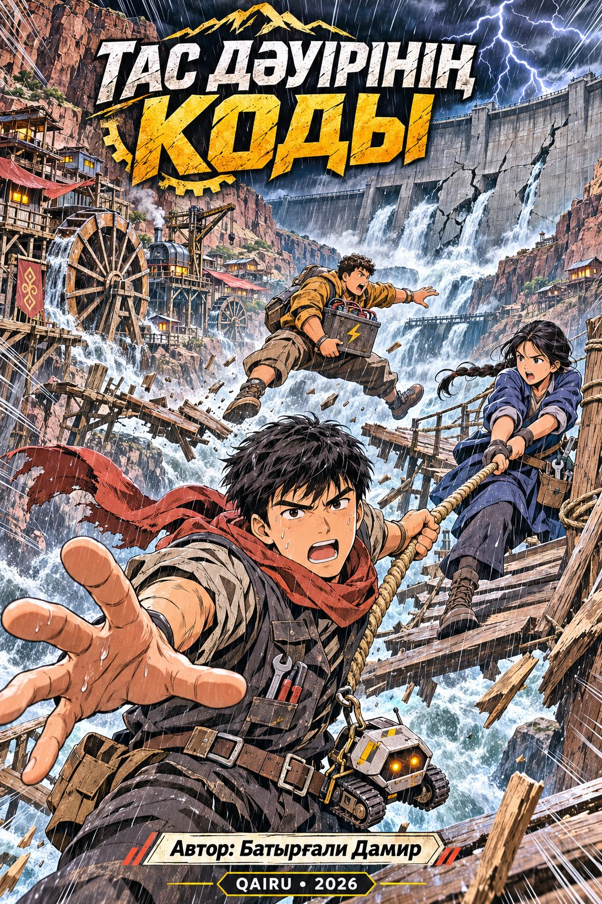

# Тас дәуірінің коды

### The Stone Age Code

  

**Екі ауыл. Екі күн. Бір мүмкіндік.**

Қазақ тіліндегі жасанды интеллект туралы иллюстрациялық оқу мангасы. Сәкен, Айлин, Алан және К-01 зақымданған бөгеттен екі ауылды құтқаруға тырысады. Жол таңдау, жоғалған ұстазды іздеу және құрылғыларды тексеру кезінде олар AI әдістерін қолданады.

**Автор — Батырғали Дамир · QAIRU · 2026**

## Кітапты оқу және трейлерді көру

- 📖 [Кітапты ашу — PDF, A5](Tas_Dauirinin_Kody.pdf)
- ☁️ [Кітаптың Google Drive нұсқасы](https://drive.google.com/file/d/1-p7-wm-WXsETfrESezEY_lajtTke760y/view)
- ▶️ [Трейлер — YouTube](https://youtu.be/rJCWBi8rArE)
- 🎬 [Трейлер — Google Drive](https://drive.google.com/file/d/14Of4qxhpIev8jMX7AmfHbz6ET5huz1Yx/view)
- 📷 [Автордың Instagram парақшасы](https://www.instagram.com/damir.zaphkiel/)

## Кітап туралы

62 бет, оның ішінде 40 сюжеттік манга беті. Әр оқу тақырыбына төрт сюжеттік бет арналған. Кітапта сөздік, нақты өмірдегі AI кейстері, тарихи оқиғалар, 12 тапсырма мен жауаптар, техникалық қосымша, әдебиеттер және AI қолдану декларациясы бар. Ішкі бірінші және соңғы беттерде қосымша материалдарға арналған QR-кодтар орналасқан.

Осы репозиторийдегі PDF экраннан оқуға ықшамдалған. Суреттердің JPEG сығуы өзгертілді, бет өлшемі мен пиксель саны сақталды. Баспаға арналған жоғары сапалы түпнұсқа авторда сақталады.

## Он оқу тақырыбы

Төмендегі нөмірлер сюжеттік беттердің өзінде басылған.

| Тақырып | Сюжеттік беттер |
| --- | --- |
| Агенттер және орталар | 1–4 |
| Іздеу және эвристика | 5–8 |
| Жергілікті іздеу және CSP | 9–12 |
| Қарсыластық іздеу | 13–16 |
| MDP және күшейте оқыту | 17–20 |
| Ықтималдық және Байес желілері | 21–24 |
| HMM және тізбекті қорытындылау | 25–28 |
| Рационалды шешім және классикалық ML | 29–32 |
| Перцептрон және нейрондық желілер | 33–36 |
| LLM, генеративті AI және қауіпсіздік | 37–40 |

## Оқу жобасы және AI қолдану

Кітап Qazaq AI Research University (QAIRU) университетіндегі «AI негіздері» пәнінің қорытынды жобасы аясында әзірленді. Оқу тапсырмасын профессор **Жукабаева Тамара Кокеновна** әзірлеп, ұсынды. Студент-автор — **Батырғали Дамир**.

Мәтін, сюжет, иллюстрациялар және беттеу жұмыстарының бір бөлігі генеративті AI көмегімен дайындалды. Құралдар, қолдану мақсаттары, тексеру тәсілдері мен автор үлесі кітаптағы декларацияда сипатталған. Трейлер AI көмегімен жасалған көріністер мен авторлық монтажды біріктіреді.

Трейлердегі музыка — **2WEI feat. Edda Hayes — Warriors**, Imagine Dragons әнінің кавері. Музыка туралы мәлімет трейлерге қатысты.

## Files

| File | Contents |
| --- | --- |
| `Tas_Dauirinin_Kody.pdf` | Complete 62-page A5 book with internal QR pages, compressed for online reading |
| `cover.jpg` | Cover preview |
| `README.md` | Project description and links |

## English summary

**The Stone Age Code** is a Kazakh-language educational manga introducing ten AI topics through a rescue adventure. Three young characters and a tracked robot must help two villages threatened by a damaged dam. The book includes worked examples, exercises with answers, references and an AI-use disclosure.

*The future begins with the right question.*
